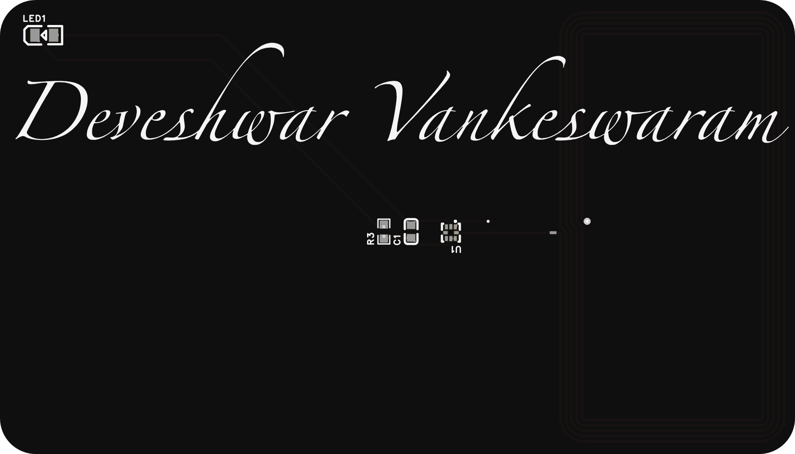
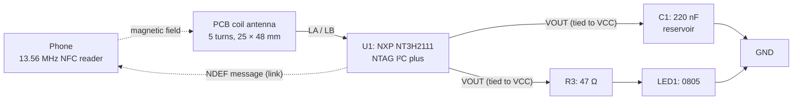
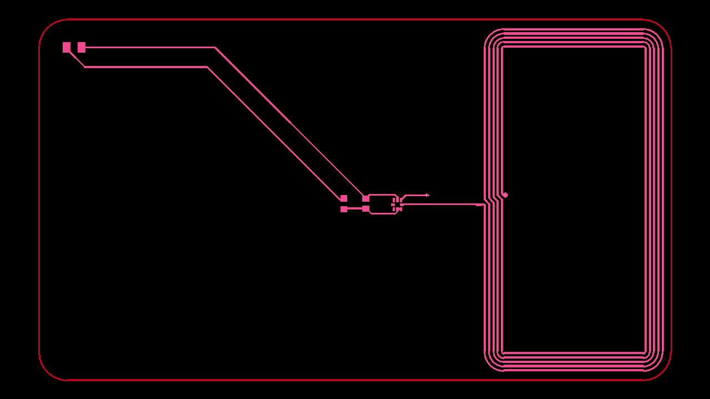

# NFC PCB Business Card

A business card made out of a circuit board. Tap it with a phone and it opens a link. The phone's own NFC field powers an LED on the card, so there's **no battery**.

<p align="center">
  
  
</p>
<p align="center"><sub>Front and back, rendered from the production Gerber files.</sub></p>

## Highlights

- **Battery-free.** An NXP NTAG I²C plus chip harvests energy from the phone's 13.56 MHz field and uses it to light the LED.
- **Antenna etched into the board.** A 5-turn coil in the top copper layer, about 25 × 48 mm, with no separate antenna part.
- **Four components.** The NFC chip, one resistor, one capacitor and one LED, all stock LCSC parts that JLCPCB can assemble.
- **Full-bleed artwork.** A script name on the front and a bull-versus-bear engraving on the back. The back carries only one tiny bridge trace, so the art covers it edge to edge.
- **Standard size.** 3.5 × 2 in (88.9 × 50.8 mm), the same as a US business card, so it fits in a wallet.

## How it works



1. **Coupling.** A phone reading NFC produces a 13.56 MHz magnetic field. The coil antenna on the card picks it up, and that field is the card's only power source.
2. **Data.** The NT3H2111 answers the phone with the NDEF message stored in its memory, usually a URL. The phone opens it, with no app needed on iOS or Android.
3. **Light.** The chip also rectifies spare field energy and puts it out on its `VOUT` pin. On this board `VOUT` is tied to `VCC` and drives the LED through a 47 Ω current-limiting resistor. The 220 nF capacitor buffers the supply, so the LED lights while the phone is in range.

## Board specs

| | |
|---|---|
| Dimensions | 88.9 × 50.8 mm (3.5 × 2 in), 4 mm corner radius |
| Layers | 2 |
| Thickness | 1.6 mm FR-4 |
| Copper | 1 oz outer layers |
| Soldermask / silkscreen | Black / white |
| Surface finish | HASL |
| Antenna | 5 turns, 0.3 mm trace / 0.3 mm gap, top copper |
| Antenna crossover | 2 vias + one bottom-layer bridge trace |
| Finest-pitch part | U1, XQFN-8, 1.6 × 1.6 mm, 0.5 mm pitch |
| Design tool | EasyEDA Pro 2.2 |

## Bill of materials

| Ref | Part | Value | Package | Manufacturer | LCSC # |
|---|---|---|---|---|---|
| U1 | NT3H2111W0FHKH (NTAG I²C plus, 1 kB) | 13.56 MHz | XQFN-8 | NXP | [C710403](https://www.lcsc.com/product-detail/C710403.html) |
| C1 | CL10B224KA8NNNC | 220 nF | 0603 | Samsung | [C21120](https://www.lcsc.com/product-detail/C21120.html) |
| R3 | 0603WAF470JT5E | 47 Ω | 0603 | Uni-Royal | [C23182](https://www.lcsc.com/product-detail/C23182.html) |
| LED1 | KT-0805Y | — | 0805 | Kento | [C2296](https://www.lcsc.com/product-detail/C2296.html) |
| U2 | PCB coil antenna | 25 × 48 mm | copper trace | — | — |

The machine-readable version is [`hardware/bom.csv`](hardware/bom.csv).

## Under the soldermask

<p align="center">
  
</p>

**Design notes**

- **Antenna on the right.** The coil takes the right third of the card and nothing is placed inside the loop. The LED and passives sit well away from it.
- **Direct antenna runs.** U1 sits between the passives and the coil, with short straight traces to both antenna terminals.
- **No connector, battery or header.** The tag is written over NFC, so the board needs nothing else.

## Repository layout

```
.
├── hardware/
│   ├── gerbers/     # Gerber and drill files ready for fabrication (EasyEDA Pro export)
│   └── bom.csv      # Bill of materials with LCSC part numbers
└── docs/images/     # Board renders and copper layout
```

## Make your own

1. **Fabricate.** Zip the contents of [`hardware/gerbers/`](hardware/gerbers) and upload the zip to [JLCPCB](https://jlcpcb.com). The zip is also attached to the [latest release](../../releases/latest). The settings that match the specs above are 2 layers, 1.6 mm and black mask.
2. **Assemble.** Upload `hardware/bom.csv` for SMT assembly. The resistor, capacitor and LED can be soldered by hand. The XQFN-8 chip needs hot air or reflow.
3. **Program.** Install a free NFC writer app such as *NFC Tools* (iOS or Android). Write a URL record to the card, and then tapping it opens that link on any phone.

## Built with

EasyEDA Pro · NXP NTAG I²C plus (NT3H2111) · JLCPCB fabrication · LCSC components
